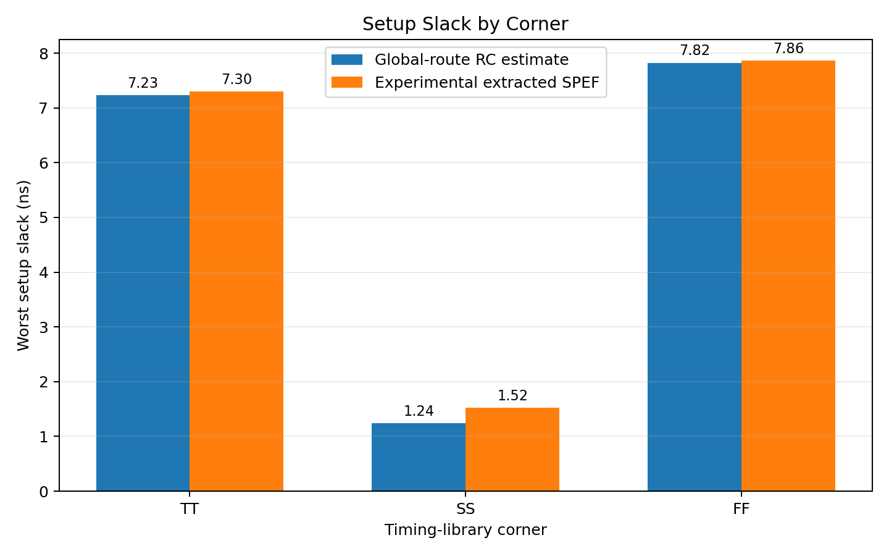
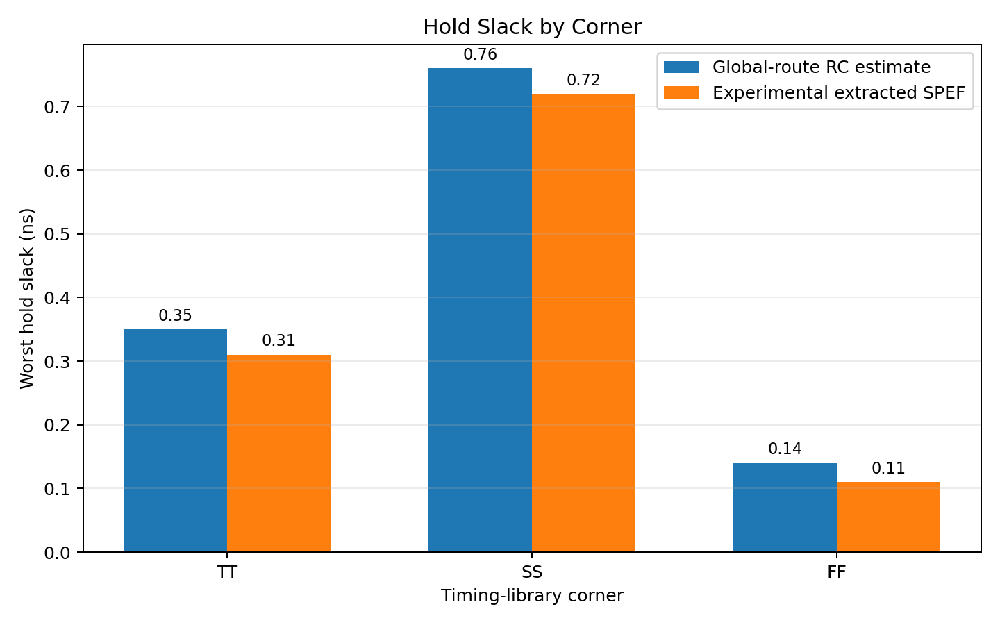
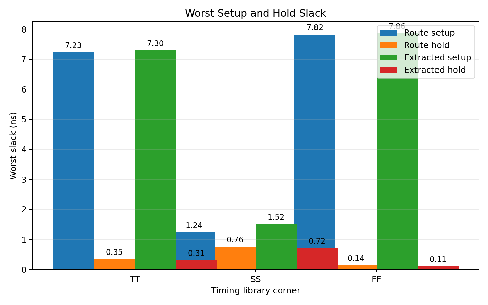
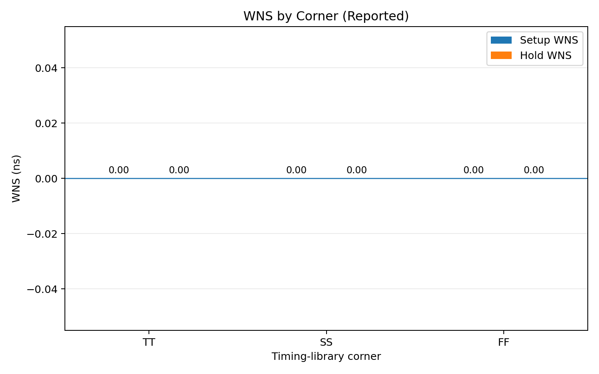
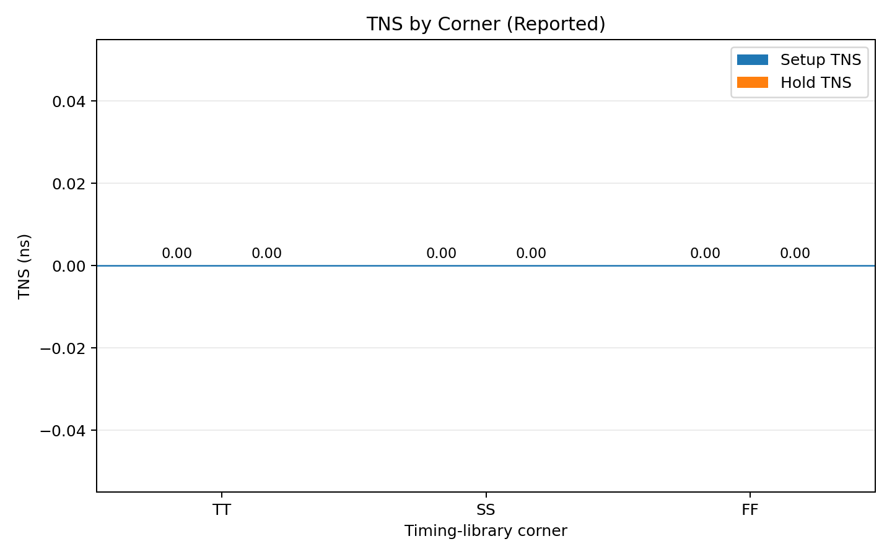

# I2C Bus Hang Detection and Automatic Recovery Controller

A Verilog HDL project for detecting an I2C bus hang and attempting automatic recovery through SCL clock pulses.

## Features
- Detects stuck I2C bus conditions.
- Generates up to nine SCL recovery pulses.
- Monitors SDA and SCL and reports persistent faults.
- Includes Verilog testbenches and GTKWave simulation evidence.
- Synthesized with Yosys and implemented using OpenROAD with the Sky130HD library.

## Repository Structure
- `rtl/` — RTL source code.
- `tb/` — verification testbenches.
- `sim/` — simulation waveforms.
- `docs/` — screenshots and synthesis statistics.
- `deliverables/` — physical-design and timing reports.
- `i2c_recovery_submission.zip` — project submission archive.

## Verification
Recorded test results include normal-idle checks, SDA release during recovery, nine-pulse recovery checks, and stuck-bus fault detection. See the testbenches and `sim/i2c_recovery.vcd` for details.

## Synthesis Results
Yosys reports 146 mapped standard cells, a synthesis cell area of 1371.3152 um^2, sequential-cell area of 603.0784 um^2, and 10 ports. See `docs/synthesis_statistics.txt`.

## Timing and Physical Design
The project contains floorplanning, placement, clock-tree synthesis, routing, and final-layout artifacts. Recorded routing logs report zero routing violations, and the recorded LVS log reports matching netlists.

**STA limitation:** The documented TT, SS, and FF runs reuse the same extracted SPEF. These are experimental comparisons, not corner-specific parasitic extraction or foundry signoff.

## Waveform


## Run the Existing Waveform
```bash
gtkwave sim/i2c_recovery.vcd
```

## Download
[Project submission ZIP](i2c_recovery_submission.zip)

## Design Evidence

### GTKWave Simulation


### OpenROAD Placement


### KLayout Design View


### Final Layout


## All-Corner Static Timing Analysis (STA)

The controller was evaluated at TT, SS, and FF timing-library corners. Two result sets are kept separate: global-route parasitic estimates and experimental extracted-SPEF analysis.

### Global-Route Parasitic Estimates

| Corner | Worst Setup Slack (ns) | Worst Hold Slack (ns) | Setup WNS (ns) | Setup TNS (ns) | Hold WNS (ns) | Hold TNS (ns) |
|---|---:|---:|---:|---:|---:|---:|
| TT | +7.23 | +0.35 | 0.00 | 0.00 | 0.00 | 0.00 |
| SS | +1.24 | +0.76 | 0.00 | 0.00 | 0.00 | 0.00 |
| FF | +7.82 | +0.14 | 0.00 | 0.00 | 0.00 | 0.00 |

### Experimental Extracted-SPEF Results

| Corner | Worst Setup Slack (ns) | Worst Hold Slack (ns) | Setup WNS (ns) | Setup TNS (ns) | Hold WNS (ns) | Hold TNS (ns) |
|---|---:|---:|---:|---:|---:|---:|
| TT | +7.30 | +0.31 | 0.00 | 0.00 | 0.00 | 0.00 |
| SS | +1.52 | +0.72 | 0.00 | 0.00 | 0.00 | 0.00 |
| FF | +7.86 | +0.11 | 0.00 | 0.00 | 0.00 | 0.00 |

WNS and TNS are the explicit values reported by OpenSTA for the checked setup and hold path groups. Worst slack gives the smallest reported timing margin; it is not interchangeable with TNS.

### STA Graphs

#### Setup Slack



#### Hold Slack



#### Worst Setup and Hold Slack



#### Worst Negative Slack (WNS)



#### Total Negative Slack (TNS)



### STA Methodology and Limitations

- Global-route results use `estimate_parasitics -global_routing`; they are estimates, not extracted-parasitic signoff.
- Extracted-SPEF results use experimental Sky130HD test extraction rules. The same SPEF was reused across TT, SS, and FF timing-library runs.
- The results are preliminary. Corner-specific parasitic extraction, constraint/path-coverage review, and independent signoff remain outstanding.
- See `deliverables/sta/` for the detailed scripts, logs, and summaries.
