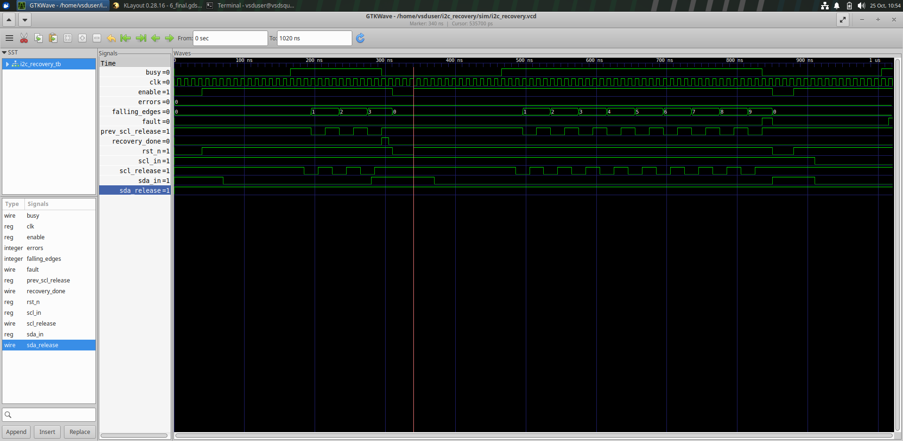
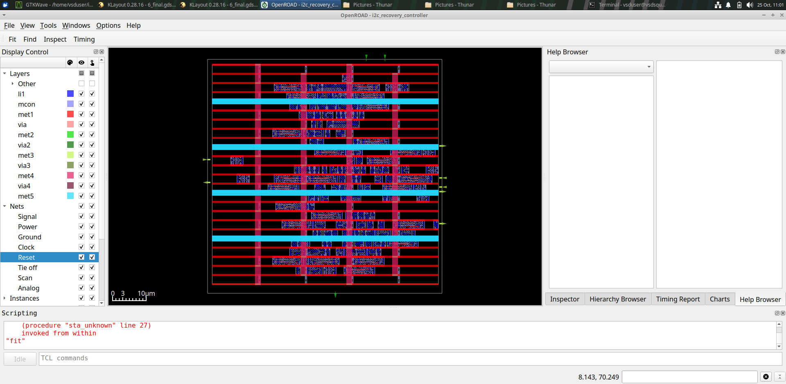
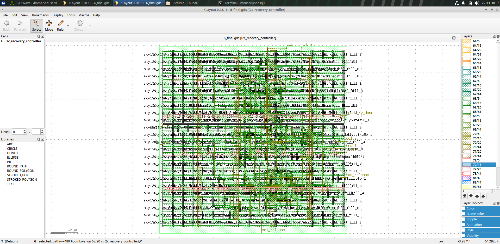
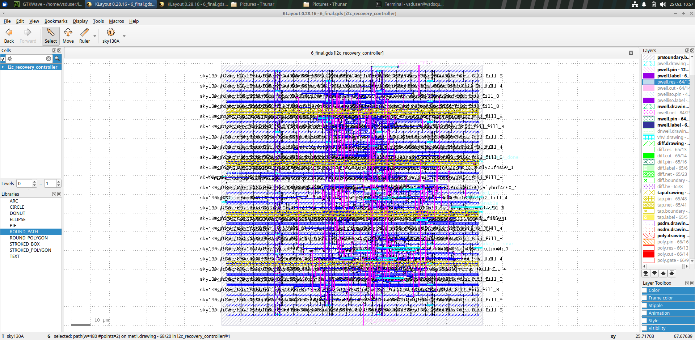

# I2C Bus Hang Detection and Automatic Recovery Controller

A Verilog HDL project for detecting an I2C bus hang and attempting automatic recovery through SCL clock pulses.

## Features
- Detects stuck I2C bus conditions.
- Generates up to nine SCL recovery pulses.
- Monitors SDA and SCL and reports persistent faults.
- Includes Verilog testbenches and GTKWave simulation evidence.
- Synthesized with Yosys and implemented using OpenROAD with the Sky130HD library.

## Repository Structure
- `rtl/` — RTL source code.
- `tb/` — verification testbenches.
- `sim/` — simulation waveforms.
- `docs/` — screenshots and synthesis statistics.
- `deliverables/` — physical-design and timing reports.
- `i2c_recovery_submission.zip` — project submission archive.

## Verification
Recorded test results include normal-idle checks, SDA release during recovery, nine-pulse recovery checks, and stuck-bus fault detection. See the testbenches and `sim/i2c_recovery.vcd` for details.

## Synthesis Results
Yosys reports 146 mapped standard cells, a synthesis cell area of 1371.3152 um^2, sequential-cell area of 603.0784 um^2, and 10 ports. See `docs/synthesis_statistics.txt`.

## Timing and Physical Design
The project contains floorplanning, placement, clock-tree synthesis, routing, and final-layout artifacts. Recorded routing logs report zero routing violations, and the recorded LVS log reports matching netlists.

**STA limitation:** The documented TT, SS, and FF runs reuse the same extracted SPEF. These are experimental comparisons, not corner-specific parasitic extraction or foundry signoff.

## Waveform


## Run the Existing Waveform
```bash
gtkwave sim/i2c_recovery.vcd
```

## Download
[Project submission ZIP](i2c_recovery_submission.zip)

## Design Evidence

### GTKWave Simulation


### OpenROAD Placement



### KLayout Design View



### Final Layout


